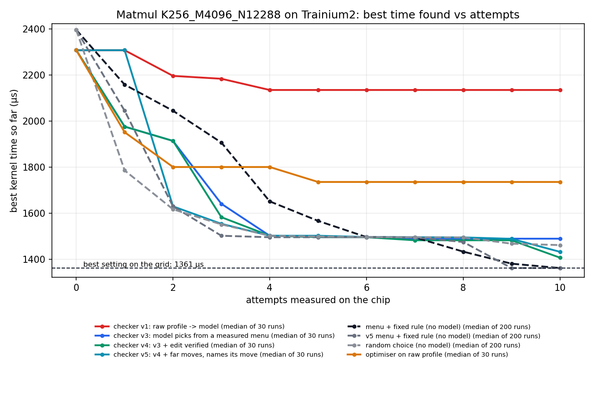
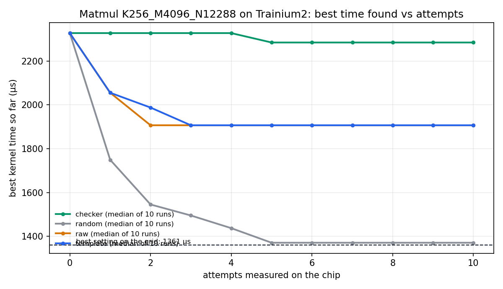

# Kernel settings, tuned on the chip by two small models

Hack the Chip (NYU × Annapurna Labs), kernel optimisation track.

A hand-written Trainium kernel has settings that decide how fast it runs. The right values change with
the shape of the data, and a wrong choice can be several times slower. This repo is a loop that picks
them automatically: a **checker** agent reads measurements taken on the real chip, an **optimiser**
agent edits the kernel, and the chip measures the result. Both agents are Qwen3-8B. No larger model is
in the loop.

The write-up and pitch are in `docs/` (`note.md`, `pitch.md`). For the idea without the jargon, start with
`docs/explainer.md`.

## What is measured

Everything below was run on a Trainium2 NeuronCore (`trn2`, one physical core, float32), verified
against NumPy on every attempt, and timed with `neuron-explorer`.

**Where settings matter and where they do not.** Every legal setting of a blocked matmul kernel, at two shapes:

| Shape | Settings | Best | Unblocked start | Worst | Within 2% of best |
|---|---|---|---|---|---|
| 2048 × 2048 × 2048 | 75 (74 run) | 904.7 µs | 1,209.3 µs | 1,209.3 µs | 39 of 75 |
| K=256, M=4096, N=12288 (adapter-style, on Qwen3-8B's layer widths) | 96 | 1,360.9 µs | 1,629.2 µs | 9,716.6 µs | 4 of 96 |

At the second shape the worst setting is 7.1x slower than the best, and AWS's tutorial default
(16, 2, 8) is not legal.

**The loop, at the second shape.** Ten attempts per run, the same ten starting settings for every arm:

| Approach | Runs | Final time, median | Worst run | Within 2% of best | Attempts with no measurement |
|---|---|---|---|---|---|
| Random choice (no model) | 200 | 1,467.0 µs | 2,097.3 µs | 35% | 0 |
| Checker v1: model reads raw profile numbers | 10 | 2,284.8 µs | 3,114.8 µs | 0 of 10 | 66 of 100 |
| Checker v2: model is shown measured single-change comparisons | 10 | 1,553.3 µs | 2,843.4 µs | 1 of 10 | 70 of 100 |
| Checker v3: model picks from a menu of measured moves | 10 | 1,491.6 µs | 3,775.8 µs | 4 of 10 | 25 of 100 |
| Checker v4: v3, and the optimiser's edit is verified before chip time | 10 | 1,494.9 µs | 1,937.6 µs | 4 of 10 | 2 of 100 |
| Checker v5: v4, with far moves, and the model names its move | 10 | 1,494.2 µs | 1,494.9 µs | 4 of 10 | 0 of 100 |
| The v3 menu with a one-line rule (no model) | 200 | 1,361.0 µs | 2,044.9 µs | 78% | 0 |

**The same experiment with three times the sample.** Thirty starting settings, each model arm on its own
Qwen3-8B server (v2 and the fixed-sentence arm were not rerun):

| Approach | Runs | Final time, median | Within 2% of best | Within 10% of best | Attempts with no measurement |
|---|---|---|---|---|---|
| Random choice (no model) | 200 | 1,460.8 µs | 77 of 200 (38%) | 145 of 200 (73%) | 0 |
| Optimiser on raw profile, no checker | 30 | 1,735.2 µs | 0 of 30 | 3 of 30 | 178 of 300 |
| Checker v1 | 30 | 2,135.2 µs | 1 of 30 | 3 of 30 | 217 of 300 |
| Checker v3 | 30 | 1,488.7 µs | 10 of 30 (33%) | 19 of 30 | 83 of 300 |
| Checker v4 | 30 | 1,406.2 µs | 15 of 30 (50%) | 26 of 30 (87%) | 5 of 300 |
| Checker v5 | 30 | 1,431.6 µs | 15 of 30 (50%) | 29 of 30 (97%) | 0 of 300 |
| The v3 menu with a one-line rule (no model) | 200 | 1,361.0 µs | 142 of 200 (71%) | 176 of 200 (88%) | 0 |

With this sample, v4 and v5 end within 10% of the best far more reliably than random (97% against 73%
for v5). They reach the best setting itself more often than random too (50% against 38%), but with
30 runs that gap is not conclusive. The one-line rule is still ahead of the model at finding the best.



The ten-start chart, with all five checker designs:



What this shows, and what it does not:

- The same small model went from far worse than random to more reliable than it, with no wasted
  attempts, only by changing what the checker tells it. Each design answers a failure read from the previous
  design's log; the reasons are in the docstrings in `kopt.py`.
- The checker's structure is what finds the best setting. A one-line rule on the same menu beats the
  8B model choosing from it.
- The tuned kernel ties the compiler's own matmul at this shape (1,360.9 µs against 1,355.1 µs). It
  does not beat it.
- The loop chooses three numbers. It does not write kernel code.
- At 2048 nothing separates the arms: more than half of all settings are already near the best.

**Per layer of Qwen3-8B.** One checker-loop run per linear-layer shape at 512 tokens, 32-bit, measured
live on the chip. "Untuned" is the kernel with all three settings at 1. "AWS compiler" is the same
multiply written as plain PyTorch and compiled by `neuronx-cc`, with no hand-written kernel.

| Qwen3-8B layer | Our kernel, untuned | Our kernel, tuned by the loop | AWS compiler | Tuned against compiler |
|---|---|---|---|---|
| Attention query and output projections | 1,075.3 µs | 906.2 µs | 908.1 µs | 0.2% faster |
| Attention key and value projections | 321.4 µs | 245.0 µs | 248.0 µs | 1.2% faster |
| Feed-forward gate and up projections | 3,117.5 µs | 2,667.2 µs | 2,665.9 µs | 0.05% slower |
| Feed-forward down projection | 3,029.1 µs | 2,664.7 µs | 2,706.3 µs | 1.5% faster |
| Whole model, 252 projections | 434.1 ms | 370.9 ms | 372.6 ms | 0.5% faster |

Untuned, the hand-written kernel is 14% to 31% slower than the compiler. Tuned by the loop it is level
with it on every layer. This is a tie, not a win: the compiler was measured on different seats from the
kernel, and timings across seats have agreed to about 0.3%. The totals are sums of standalone kernel
times, not the model running. Raw compiler measurements: `results/compiler_default_layers.json`.

At 16-bit, measured as one whole feed-forward block (three multiplies) by inference time:

| One Qwen3-8B feed-forward block, 16-bit | Inference time |
|---|---|
| Our kernel, untuned | 8,635 µs |
| Our kernel, tuned by the loop (five runs) | 2,862 to 2,894 µs |
| Best of all 72 settings | 2,860 µs |
| AWS compiler | 2,745 µs |

**Inside a model.** `inference/` puts the kernel into a traced PyTorch model on the chip and times whole-model
inference (median wall clock of 50 calls). For two feed-forward blocks at Qwen3-8B's sizes, 512 tokens,
32-bit: 20.12 ms with the unblocked kernel, 17.40 ms with the settings the loop chose per layer (13.5%
less), 17.26 ms with PyTorch's own matmul. At 16-bit the spread between settings is 3.3x (16.53 ms to
5.02 ms, PyTorch 4.77 ms) and the 32-bit settings are 1.7x off the best; those 16-bit settings were
found by hand.

The loop was then run at 16-bit itself, scored on the inference time of one such block
(`inference/kopt16.py`, the same loop code with only the measurement replaced). All 72 settings were
measured for ground truth: best 2,860 µs, worst 8,635 µs. Five runs from five different starts, as slow
as 8,628 µs, all ended between 2,862 and 2,894 µs, within 2% of the best and 4% to 5% behind plain
PyTorch (2,745 µs). Random choice also ends within 2% of the best in 166 of 200 runs on this problem,
so this shows the loop working on real inference time, not the model beating random. These are small
models with random weights, not Qwen3-8B itself.

## Files

| File | What it is |
|---|---|
| `kernels/matmul_blocked.py` | The kernel being tuned: AWS's tutorial blocked matmul, with its three block-size lines set to 1 |
| `chip.py` | Compile one kernel, run it on a NeuronCore, verify it against NumPy, profile it |
| `hwcheck.py` | The same on-chip check for the hackathon's `nkibench.py` levels (its missing layers 2 and 3) |
| `kopt.py` | The loop: the checker and optimiser agents, every arm, and the no-model baselines |
| `report.py` | Tables and charts from the attempt logs |
| `results/grid_*.jsonl` | Every setting measured on the chip, one JSON line each |
| `runs/*.jsonl` | Every attempt of every run: setting, stage reached, time, the checker's instruction, the optimiser's reply |
| `results/summary_*.json`, `curve_*.csv`, `curve_*.png` | The numbers and charts above (`s30` = the 30-start experiment) |
| `inference/` | The kernel inside a traced PyTorch model: scripts, raw results and setup notes |

## Reproduce it

You need two seat pods from the hackathon cluster: one serves the model, the other's chip runs
kernels. They cannot be the same seat, because the model server takes every core on its chip.

### 1. Without a chip: recompute the tables from the logs (any laptop)

```bash
pip install matplotlib
S=K256_M4096_N12288
python report.py $S runs/random_x200_s10_$S.jsonl runs/greedy_x200_s10_$S.jsonl \
    runs/raw_$S.jsonl runs/template_$S.jsonl runs/checker_$S.jsonl \
    runs/checker2_$S.jsonl runs/checker3_$S.jsonl runs/checker4_$S.jsonl runs/checker5_$S.jsonl
```

The no-model arms replay from the cached chip measurements, so they also run anywhere:

```bash
pip install httpx
python kopt.py --arm random --runs 200 --nstarts 10 --size $S --starts spread --no-live --out /tmp/random.jsonl
python kopt.py --arm greedy --runs 200 --nstarts 10 --size $S --starts spread --no-live --out /tmp/greedy.jsonl
```

### 2. With the chips: run the loop

On your laptop, with the workshop credentials and `kubectl` pointed at the cluster (the hackathon
README, steps 1 to 4). Below, `seat-A` serves the model and `seat-B` has the free chip.

```bash
# start the model on seat-A (about 4 minutes) and note its address
kubectl exec seat-A -- bash -c 'cd /workspace && ./serve.sh'
IP=$(kubectl get pod seat-A -o jsonpath='{.status.podIP}')

# put this repo on seat-B
tar cf - chip.py hwcheck.py kopt.py report.py kernels results | \
    kubectl exec -i seat-B -- bash -c 'mkdir -p /workspace/kopt && cd /workspace/kopt && tar xf -'
kubectl exec -it seat-B -- bash
```

Inside `seat-B`:

```bash
cd /workspace/kopt
export KOPT_BASE_URL=http://<IP of seat-A>:8000/v1

# one kernel on the chip: correct? how fast? how busy was each engine?
python chip.py --grid "1,1,1;4,1,2" --size K256_M4096_N12288

# the loop: checker v5 and the Qwen3-8B optimiser, 10 runs of 10 attempts
python kopt.py --arm checker5 --runs 10 --attempts 10 --size K256_M4096_N12288 \
    --starts spread --out runs/my_checker5.jsonl

# a shape nobody has measured: every attempt is compiled and timed live (about 30 s each)
python kopt.py --arm checker5 --runs 1 --attempts 10 --size K4096_M512_N4096 \
    --starts unblocked --out runs/my_layer.jsonl
```

Arms: `random`, `raw`, `template`, `checker` (v1), `checker2` … `checker5`, `greedy`, `greedy5`.
Settings already in `results/grid_<shape>.jsonl` are read from that cache instead of being measured
again; delete the file to force every attempt onto the chip.

To measure a whole grid yourself:

```bash
python chip.py --grid "1,1,1;1,1,2;..." --size K256_M4096_N12288 --reps 3 --out results/grid_mine.jsonl
```

## Things that will bite you

All found the hard way on these pods.

- **Measure at one physical core.** At the pod's default (`NEURON_LOGICAL_NC_CONFIG=2`) a kernel runs
  on both physical cores and every byte and transfer count comes back exactly doubled. `chip.py` and
  `hwcheck.py` set it to 1.
- **The model server and a kernel cannot share a chip.** The hackathon README says two cores stay
  free; on our pods every core request was refused with "cores busy" while the server was up.
- **Do not send the model server a `seed` parameter.** It killed the vLLM engine and the server had
  to be restarted.
- **Repeating a run is not an independent sample.** The server answers the same prompt almost
  identically each time, so runs here differ by their starting setting.
- **The simulator's byte counts are not the chip's.** At the hackathon's small test shapes the chip
  moved the minimum where `nki.simulate` counted up to 2x; at 2048 the waste is real on the chip.
- **Call kernels with NumPy arrays.** The pods have no `torch_neuronx`, so the torch route in AWS's
  profiling skill fails; NKI's standalone mode works.

## Credits

The kernel is adapted from the AWS Neuron NKI matrix multiplication tutorial. The hackathon harness
(`nkibench.py`, `serve.sh`) is from `yahavb/trainium-agent-labs`.
